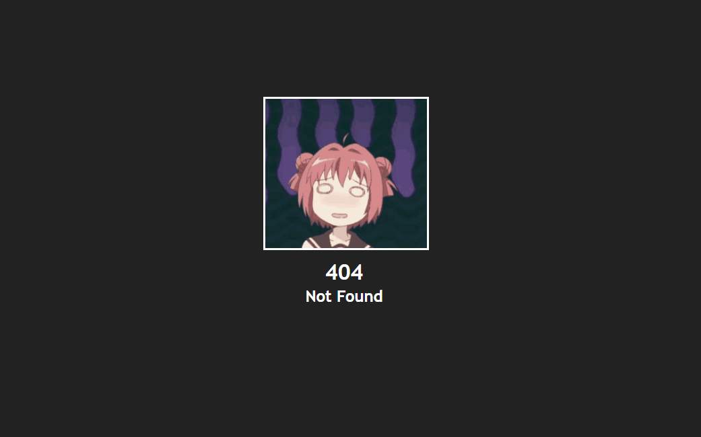
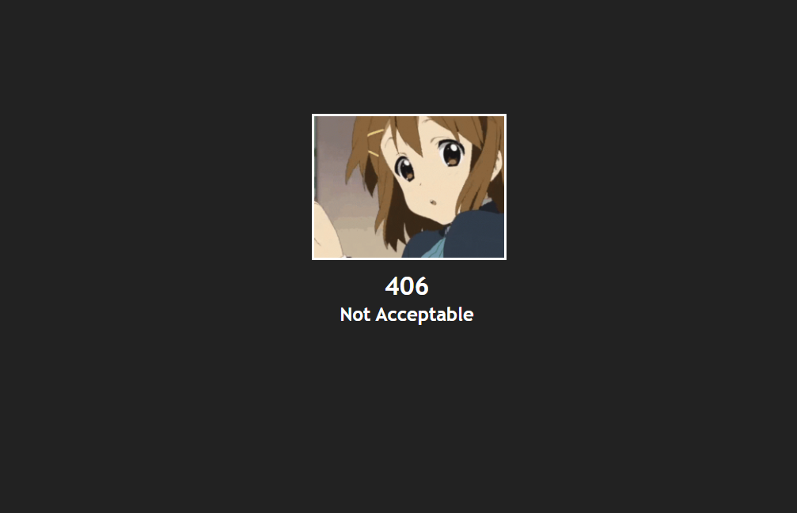

<h1 align="center" id="Template">
    
</h1>

<h3 align="center">HTTP Error Pages But With Anime Images</h3>

---

## What is this?

You may have come across some pages that says "404 Not Found". Well, that is a HTTP code which means the server has failed to get the requested file/page. There are other types of error codes which have their own meanings. This repo containes most of the Error Code's paegs but with Anime Pictures. Most of them are animated.

## How to Use

Since all the HTML files are completely self-contained (no external CSS or JS needed), you can simply copy the files from the `dist` folder into your web server's root or error pages directory.

### For Nginx
Add the following `error_page` directives to your `nginx.conf` or server block (make sure the path matches where you put the HTML files):

```nginx
server {
    # ... your other config ...
    
    error_page 404 /404.html;
    error_page 500 /500.html;

    location ~ ^/(404|500)\.html$ {
        root /path/to/your/error/pages;
        internal;
    }
}
```

### For Apache (.htaccess)
If you are using Apache, you can drop these files into your server and add the following lines to your `.htaccess` file:

```apache
ErrorDocument 404 /404.html
ErrorDocument 500 /500.html
```
## Contributing

You can also contribute to this project!
If i missed any HTTP code, Feel free to open an issue with a suitable image for the code and I will add that to the list.

When you are ready, simply create a pull request for your contribution and I will review it whenever I can!

#
## Examples :

>#### Error Page for 404

>#### Error Page for 406
